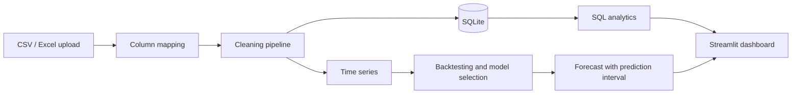

<div align="center">

# Sales Analytics Dashboard with Forecasting

**Clean sales data, explore it with SQL-powered analytics, and forecast future sales with honestly tested models.**

[](https://github.com/YOUR-USERNAME/sales-dashboard/actions)


</div>

<!-- After deploying, add:  **Live demo:** https://your-app.streamlit.app -->

An interactive dashboard that takes raw sales transactions (CSV or Excel), cleans them automatically, analyses them with SQL, and forecasts future sales. Several forecasting models are compared with rolling-origin backtesting against a simple baseline, and the best one is selected automatically and shown with a prediction interval.

**Contents:** [Screenshots](#screenshots) · [Features](#features) · [Results on real data](#results-on-real-data) · [How it works](#how-it-works) · [Getting started](#getting-started) · [Using your own data](#using-your-own-data) · [Project structure](#project-structure) · [Testing](#testing) · [Limitations](#limitations) · [Roadmap](#roadmap)

---

## Screenshots

| Overview | Forecast Studio |
| --- | --- |
|  |  |

| Model comparison | Sales analysis |
| --- | --- |
|  |  |

## Features

- **Overview:** KPI cards (revenue, profit, orders, average order value, units sold) with growth against the previous period of equal length, trend charts (daily to yearly), revenue by category, top products and regions.
- **Sales analysis:** breakdown by nine dimensions (category, sub-category, region, state, city, customer segment, channel, product, shipping mode), ABC (Pareto) analysis, new vs returning customers, and anomaly detection.
- **Forecast Studio:** forecast total sales or a single category or region at monthly, weekly or daily level, with a configurable horizon and an 80% or 95% prediction interval. Shows the selected model, backtest error, a model-comparison table and a downloadable forecast.
- **Data upload and quality report:** upload a CSV or Excel file, map its columns to the expected fields, and see exactly what was cleaned: duplicates, returns, missing values and outliers.
- **Global filters:** date range or preset, category, region, sales channel and customer segment.
- **CSV downloads** for breakdowns, ABC analysis, forecasts and the cleaned data.
- **Clean, consistent UI** with a custom theme; the layout adapts to narrow screens.

## Results on real data

Tested on the public **Superstore** sales dataset (4 years of orders, 2014 to 2017: about $2.30M revenue, 5,009 orders). Monthly total sales, 6-month horizon, 3 rolling-origin folds:

| Model | RMSE | MAPE (%) | vs seasonal naive |
| --- | --- | --- | --- |
| **Trend + seasonal regression (selected)** | **15,909** | **23.1** | 9% lower RMSE |
| Seasonal naive (baseline) | 17,487 | 23.7 | - |
| Gradient boosting | 18,829 | 29.2 | 8% higher RMSE |
| Holt-Winters | 19,349 | 26.4 | 11% higher RMSE |
| Naive | 40,886 | 74.7 | 134% higher RMSE |

**How to read this honestly**

- Only one of the four candidate models beat the seasonal-naive baseline, and by a modest margin. With 48 noisy monthly points, more complex models did not help.
- The result rests on 3 folds of 6 months (18 test points), so the 9% advantage is a weak signal that could change with other backtest windows.
- MAPE is inflated by low-sales months, where small absolute errors become large percentages. RMSE is the metric used to select the model.
- On the bundled synthetic data Holt-Winters wins easily. The ranking changes on real data, which is why models are compared by backtesting rather than chosen in advance.

## How it works



**1. Cleaning** (`cleaning.py`): validates required columns and names any that are missing, removes exact duplicates, drops rows missing a date or amount, separates returns (negative quantity or amount), fills missing optional fields, derives unit price when absent, and flags outliers with the IQR rule within each category. A report records every change.

**2. SQL layer** (`db.py`, `analytics.py`): cleaned data is loaded into an in-memory SQLite database with indexes. KPIs, trends, breakdowns, ABC analysis, customer analysis and anomaly detection run as SQL queries. Filter values are passed as query parameters and column names come from fixed whitelists, so filters cannot inject SQL.

**3. Forecasting** (`forecasting/`):
- Transactions are aggregated to a gap-free daily, weekly or monthly series.
- Models: naive, seasonal naive, log-linear trend with seasonal regression, gradient boosting on lag and calendar features, and Holt-Winters (via statsmodels).
- **Backtesting:** expanding-window, rolling-origin evaluation. Each fold trains only on data before its test window, never on a random split. A test checks that no future data leaks in.
- **Selection:** the model with the lowest average RMSE wins. Models within 1% of the best RMSE are separated by MAPE. The app warns when no model beats the seasonal-naive baseline.
- **Prediction interval:** taken from the selected model's pooled backtest errors.

## Getting started

**Requirements:** Python 3.10 or newer (developed and tested on 3.11).

```bash
git clone https://github.com/YOUR-USERNAME/sales-dashboard.git
cd sales-dashboard

# optional: create a virtual environment
python -m venv .venv
.venv\Scripts\activate          # Windows
# source .venv/bin/activate     # macOS / Linux

pip install -r requirements-dev.txt
streamlit run app.py            # opens http://localhost:8501
```

Run the tests:

```bash
pytest
```

Run the pipeline from the command line (clean, KPIs, model comparison, forecast):

```bash
python scripts/run_pipeline.py --freq M --horizon 6
```

## Using your own data

Choose **Upload file** in the sidebar and select a CSV or Excel file. The app suggests a column mapping that you can correct. If your dates are day-first (dd/mm/yyyy), tick the day-first box.

| Required field | Meaning |
| --- | --- |
| `order_id` | Order identifier (one order can have several lines) |
| `order_date` | Date of the sale |
| `product_id` | Product identifier |
| `category` | Product category |
| `quantity` | Units sold |
| `sales_amount` | Revenue of the line |

Optional fields such as region, state, city, customer, segment, channel, discount, cost and profit are used when present and filled with defaults when missing. Common Superstore headers (`Order ID`, `Order Date`, `Sales`, `Sub-Category`, `Segment`) are recognised automatically.

**About the sample data:** `data/superstore_synthetic.csv` is **synthetic**. It was generated with the Superstore column structure (including a trend, seasonality, duplicates, returns and missing values) so the app works out of the box and the cleaning logic can be tested. Do not read accuracy figures from it. The results above come from the real Superstore dataset, which is not included in this repository. Download it separately and upload it in the app.

The app keeps data in an in-memory database and does not write uploaded data to disk or send it to external services.

## Project structure

```
sales-dashboard/
├── app.py                      Streamlit dashboard (4 pages)
├── check.py                    Independent pandas cross-check of the headline KPIs
├── requirements.txt            Runtime dependencies
├── requirements-dev.txt        Runtime dependencies + pytest
├── pyproject.toml              Package metadata and pytest settings
├── .streamlit/config.toml      Theme and toolbar settings
├── .github/workflows/ci.yml    Tests and pipeline run on every push
├── data/
│   └── superstore_synthetic.csv    Synthetic sample data
├── screenshots/                Images used in this README
├── scripts/
│   └── run_pipeline.py         Command-line pipeline
├── src/salesdash/
│   ├── cleaning.py             Validation, cleaning and the quality report
│   ├── mapping.py              Column mapping for uploaded files
│   ├── db.py                   SQLite loading and summary tables
│   ├── analytics.py            KPIs, trends, breakdowns, ABC, customers, anomalies
│   ├── charts.py               Plotly figure builders
│   ├── styles.py               CSS for the dashboard
│   └── forecasting/
│       ├── series.py           Transactions to a regular time series
│       ├── models.py           Forecasting models
│       ├── backtest.py         Rolling-origin backtesting, ranking and selection
│       ├── forecast.py         Final forecast and prediction intervals
│       └── metrics.py          MAE, RMSE, MAPE, sMAPE, bias, coverage
└── tests/                      48 pytest tests
```

## Testing

48 automated tests cover:

- cleaning rules and the required-column check
- KPI and filter results compared against pandas
- protection against SQL injection (malicious dimension names and filter values)
- metric formulas on hand-calculated values
- backtest leakage (each fold trains only on earlier data)
- model ranking, tie-breaking and the "not enough history" error
- prediction-interval behaviour
- column mapping for real Superstore headers and Windows-encoded files

GitHub Actions runs the tests and the pipeline script on every push to `main`. `check.py` recomputes the headline numbers in plain pandas as an independent check of the dashboard.

## Limitations

- Prediction intervals come from pooled backtest errors, so their width is roughly constant across the horizon. Real uncertainty grows further ahead.
- The model ranking uses 3 backtest folds, which is a small sample (see the note on results above).
- Forecasts assume the future resembles the past. Promotions, holidays, launches and external shocks are not modelled.
- Daily, weekly and monthly summary tables are totals only, so the filtered dashboard pages query the transaction table directly.
- Forecast Studio uses the full history of the chosen scope; the sidebar date filters do not apply to it.
- There is no user login, and exports are CSV only.

## Roadmap

- More models: SARIMA, XGBoost or LightGBM, and Prophet
- Holiday and promotion features
- Prediction intervals that widen with the forecast horizon, and a coverage check
- A choice of backtest folds in the interface
- PDF and Excel export
- A FastAPI back end with PostgreSQL, and user accounts with roles

## Author

Built by [@YOUR-USERNAME](https://github.com/YOUR-USERNAME).
